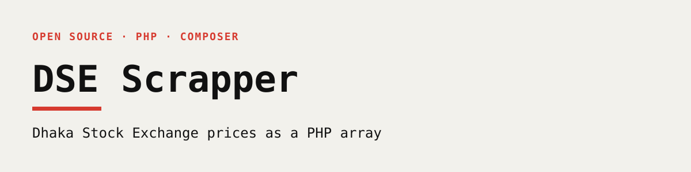
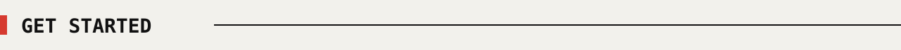
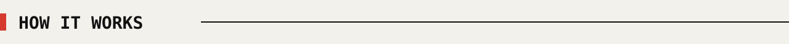
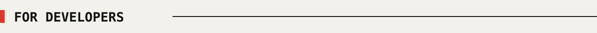

<div align="center">

# DSE Scrapper



**One call, one array.** Latest DSE share prices.

`MIT` `PHP 7.4+` `Composer`

</div>

<br>



> [!NOTE]
> DSE retired the old `latest_share_price_all.php` page (410 Gone). The scraper now reads `https://www.dsebd.org/api/live/snapshot`, the JSON feed behind the site's own Latest Share Price page. It is undocumented, so if DSE changes it, `scrap()` throws instead of returning an empty array.

**1. Add it to `composer.json`:**

```json
{
    "require": {
        "nadimtuhin/dse-scrapper": "0.1.*@dev"
    }
}
```

**2. Install:**

```bash
composer install
```

**3. Run it:**

```php
require_once('vendor/autoload.php');

$scrapper = new NadimTuhin\DSE\DseScrapper();
$data = $scrapper->scrap();

print_r($data);
```

Save as `run.php`, then run `php run.php`.

<br>



**Three small steps.** `Downloader` fetches the live price snapshot from `dsebd.org`. `Parser` reads each row by column name. `Transformer` maps them to the keys below.

**Numbers are numbers.** Prices, `value` (in million Tk) and `volume` come back as ints or floats. `change` is `ltp - ycp`, rounded to 2 places. The list covers every board DSE reports, including bonds, so expect more than 600 rows.

<br>



Everything below is reference. You don't need it to get started.

# Dhaka Stock Exchange Scrapper
Scrapping Dhaka Stock Exchange (DSE) data were never easier. Easy to use API. Pull requests, bug reports, feature requests are welcome.

## Disclaimer:
This software is to be used `For Educational Purposes Only` . If this software is used against the Terms and Conditions stated in `dsebd.org` the author would not be responsible.

## Install 
install using composer
```json
{
    "require": {
        "nadimtuhin/dse-scrapper": "0.1.*@dev"
    }
}
```

## Usage
```php
require_once('vendor/autoload.php');

$scrapper = new NadimTuhin\DSE\DseScrapper();
$data = $scrapper->scrap();

print_r($data);
```


## Data Structure
```php
array:629 [▼
  0 => array:10 [▼
    "trading_code" => "1JANATAMF"
    "ltp" => 3.2
    "high" => 3.3
    "low" => 3.1
    "closep" => 3.2
    "ycp" => 3.2
    "change" => 0.0
    "trade" => 125
    "value" => 1.362
    "volume" => 426854
  ]
  1 => array:10 [▼
    "trading_code" => "GP"
    "ltp" => 226.4
    "high" => 227.1
    "low" => 226.3
    "closep" => 226.4
    "ycp" => 226.8
    "change" => -0.4
    "trade" => 842
    "value" => 20.8
    "volume" => 91801
  ]
  2 => array:10 [▶]
  3 => array:10 [▶]
  4 => array:10 [▶]
  5 => array:10 [▶]
  6 => array:10 [▶]
  7 => array:10 [▶]
  8 => array:10 [▶]
  9 => array:10 [▶]
  10 => array:10 [▶]
  11 => array:10 [▶]
  12 => array:10 [▶]
  13 => array:10 [▶]
  ....
```
